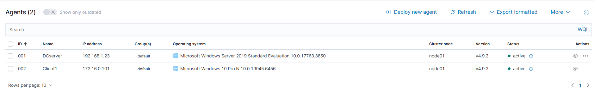
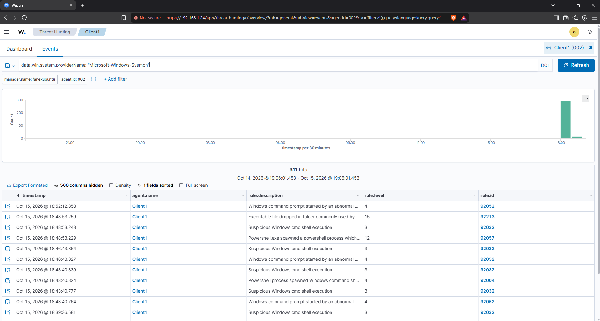
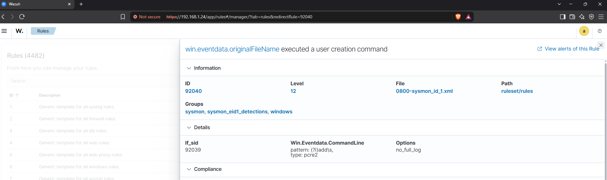
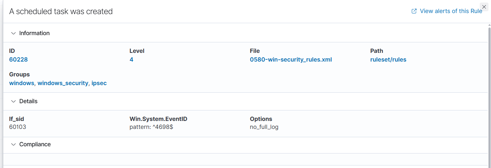
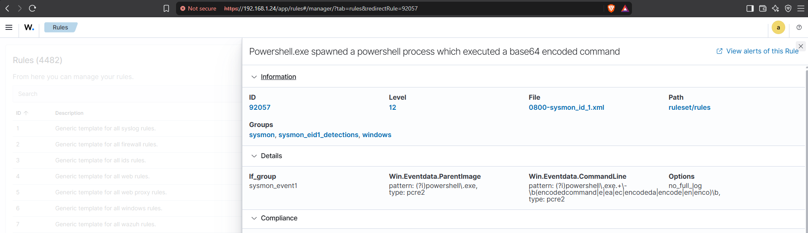

# Active Directory + Wazuh SIEM Detection Lab

A home lab that builds a small Active Directory environment, adds a Wazuh SIEM with Sysmon telemetry, and validates detections by simulating MITRE ATT&CK techniques with Atomic Red Team.

> **Scope:** one domain controller, one Windows 10 workstation and one Wazuh manager, with three ATT&CK techniques simulated on the workstation. This is a learning lab, not a production design.

## Contents

- [Objectives](#objectives)
- [Architecture](#architecture)
- [What was built](#what-was-built)
- [Attack simulation and detection results](#attack-simulation-and-detection-results)
- [Evidence](#evidence)
- [Troubleshooting log](#troubleshooting-log)
- [Lessons learned](#lessons-learned)
- [Limitations and next steps](#limitations-and-next-steps)
- [Repository layout](#repository-layout)

---

## Objectives

- Build and administer an Active Directory domain (`fanex.local`)
- Automate common admin tasks (user onboarding) with PowerShell
- Deploy a SIEM (Wazuh) and onboard Windows endpoints
- Improve endpoint visibility with Sysmon
- Simulate attacker techniques and confirm they are detected

## Architecture

```
                     Home network 192.168.1.0/24 (bridged)
        ┌──────────────────────────┬─────────────────────────┐
        │                          │                         │
 ┌──────┴────────┐          ┌──────┴────────┐          Router / internet
 │ Wazuh manager │          │   DCserver    │             192.168.1.1
 │ Ubuntu Server │          │ Windows 2019  │
 │ 192.168.1.24  │          │ 192.168.1.23  │  (WAN NIC)
 └───────────────┘          │ 172.16.0.1    │  (LAN NIC)
                            └──────┬────────┘
                                   │  VMware LAN Segment 172.16.0.0/24
                            ┌──────┴────────┐
                            │    CLIENT1    │
                            │  Windows 10   │
                            │ 172.16.0.101  │
                            │ Sysmon + agent│
                            └───────────────┘
```

| Host | Role | Notes |
|---|---|---|
| DCserver | Domain controller, DNS, DHCP, router, file server, Enterprise Root CA | Windows Server 2019, dual-homed (LAN segment + bridged NIC), Wazuh agent |
| CLIENT1 | Domain-joined workstation | Windows 10 Pro N, Sysmon + Wazuh agent v4.9.2 |
| fanexunbuntu | Wazuh manager, indexer and dashboard (all-in-one) | Ubuntu Server, static IP `192.168.1.24` |

Platform: VMware Workstation. The domain and workstation sit on an isolated LAN segment, and DCserver routes them to the internet.

## What was built

### 1. Active Directory
- Domain `fanex.local` with an OU structure for IT, groups, users and workstations
- Group Policy, including certificate autoenrollment for the Workstations OU
- Enterprise Root CA (AD CS); CLIENT1 received a machine certificate through autoenrollment
- File server role with a hidden `Homes$` share and restricted NTFS permissions
- PowerShell onboarding automation that creates users, department groups and home folders

### 2. Wazuh SIEM
- Wazuh all-in-one install on Ubuntu Server (manager, indexer, dashboard)
- Wazuh agents on DCserver and CLIENT1, both reporting as **Active**
- Log ingestion confirmed in **Threat Hunting > Events**

### 3. Sysmon telemetry
- Sysmon installed on CLIENT1 with the SwiftOnSecurity configuration ([`scripts/install-sysmon.ps1`](scripts/install-sysmon.ps1))
- Agent configured to collect the Sysmon channel ([`configs/ossec-sysmon-localfile.xml`](configs/ossec-sysmon-localfile.xml))

Sysmon is deployed on CLIENT1 only. DCserver reports standard Windows event logs through its agent.

## Attack simulation and detection results

Techniques were simulated on CLIENT1 with [Atomic Red Team](https://github.com/redcanaryco/atomic-red-team) ([`scripts/atomic-red-team-tests.ps1`](scripts/atomic-red-team-tests.ps1)). Each test was cleaned up afterwards.

| ATT&CK technique | Atomic test | Detected by | Wazuh rule | Level |
|---|---|---|---|---|
| T1136.001 Create Account: Local Account | Test 4: create a new user in a command prompt | Sysmon process creation (Event ID 1): `net user ... /add` | **92040** "executed a user creation command" | 12 |
| T1053.005 Scheduled Task | Test 2: scheduled task (local) | Windows Security Event ID 4698 | **60228** "A scheduled task was created" | 4 |
| T1059.001 PowerShell | Encoded PowerShell command | Sysmon process creation (Event ID 1) | **92057** "Powershell.exe spawned a powershell process which executed a base64 encoded command" | 12 |

Supporting alerts seen during the tests:

| Rule | Description | Level |
|---|---|---|
| 92213 | Executable file dropped in folder commonly used by malware | 15 |
| 92052 | Windows command prompt started by an abnormal process | 4 |
| 92004 | PowerShell process spawned Windows command shell instance | 4 |
| 92032 | Suspicious Windows cmd shell execution | 3 |

**Observations**
- Rule 92040 matches the command line (`add` followed by whitespace, case-insensitive), so it fires on the *attempt*. In one run the domain password policy rejected the new account (exit code 2) and the detection still triggered.
- Rule 92057 matches `powershell.exe` launched by `powershell.exe` with an encoded-command parameter (and its shortened forms), so no script block logging was needed to catch it.
- The scheduled task detection depends on Windows Security Event 4698, which requires the **Audit Other Object Access Events** audit subcategory to be enabled. It is not on by default.
- Detections 92040 and 92057 are command-line pattern matches, so heavily obfuscated variants may behave differently.

## Evidence

**Both agents Active**



**Sysmon events from CLIENT1 in Wazuh, including the PowerShell test alerts (rules 92057, 92213, 92032)**



**Rule 92040: user creation command (T1136.001)**



**Rule 60228: scheduled task created, Event ID 4698 (T1053.005)**



**Rule 92057: base64 encoded PowerShell command (T1059.001)**



## Troubleshooting log

Problems hit along the way and how each was fixed.

| Problem | Cause | Fix |
|---|---|---|
| LDAP/DNS lookups failing on the domain controller | Dual-homed DC with no adapter priority | Set interface metrics (LAN 1, WAN 100) and restarted Netlogon and DNS |
| First Wazuh install failed at the dashboard step | Virtual disk only about 10 GB | Grew the disk and extended the partition, LVM and filesystem; later rebuilt the manager on a new VM with more RAM and disk |
| Wazuh dashboard could not authenticate to the indexer | `admin` / `kibanaserver` passwords out of sync | Reset the passwords with the Wazuh password tool |
| Both agents showed **Disconnected** after a break | Manager VM's DHCP lease changed from `192.168.1.24` | Set a static IP with netplan ([`configs/netplan-50-cloud-init.yaml`](configs/netplan-50-cloud-init.yaml)) and disabled cloud-init network config so it persists |
| Config edit did not apply | `/etc/netplan/50-cloud-init.yaml` still had `dhcp4: true` because the edit had not been saved | Rewrote the file with `tee`, then `netplan apply` and verified with `ip a` |
| CLIENT1 could not resolve internet names | DNS on DCserver was not forwarding external queries (lookups straight to 8.8.8.8 worked) | Added a DNS forwarder on DCserver |
| Atomic Red Team install failed | PowerShell session not elevated; execution policy was Restricted | Opened an elevated session and ran `Set-ExecutionPolicy Bypass -Scope Process` |
| Atomic test reported "found 0 tests" | Used a test number that does not exist | Listed valid numbers with `-ShowDetailsBrief` |

## Lessons learned

- A SIEM is only as good as its telemetry. Sysmon command-line visibility is what made the account-creation and PowerShell detections possible.
- Wazuh's default ruleset caught all three techniques without any custom rules, but the quality of detection depends on which audit policies and log sources are enabled.
- Most of the effort went into infrastructure troubleshooting (DNS, IP addressing, permissions, services), which mirrors real operations work.
- Atomic tests should only be run in isolated lab machines, and always cleaned up afterwards.

## Limitations and next steps

- Only three techniques were tested, on one workstation
- Sysmon is not deployed on the domain controller
- Not yet tested: obfuscated `-EncodedCommand` variants, credential access (T1003) and lateral movement
- Planned: PowerShell script block logging and command-line auditing through Group Policy
- Planned: write custom Wazuh rules for any detection gaps found

## Repository layout

```
.
├── README.md
├── screenshots/                 Evidence from the Wazuh dashboard
├── configs/
│   ├── ossec-sysmon-localfile.xml   Wazuh agent config to collect Sysmon logs
│   └── netplan-50-cloud-init.yaml   Static IP for the Wazuh manager
└── scripts/
    ├── install-sysmon.ps1           Sysmon install (SwiftOnSecurity config)
    └── atomic-red-team-tests.ps1    Atomic Red Team setup and tests used
```

## Tools and skills demonstrated

Windows Server 2019, Active Directory, AD CS, Group Policy, DNS/DHCP, PowerShell automation, Wazuh SIEM, Sysmon, Atomic Red Team, MITRE ATT&CK, Ubuntu Server administration (netplan, systemd, LVM), VMware Workstation networking.

## Disclaimer

Everything here was run in an isolated personal lab. Do not run attack simulations on systems you do not own or have explicit permission to test.
